<p align="center">
  <picture>
    <source media="(prefers-color-scheme: light)" srcset="assets/banner-light.svg">
    
  </picture>
</p>

# 🧠 Second Brain Skills

> **Wirf Quellen rein. Bekomm ein Wiki raus, das sich selbst pflegt.**
> Vier Agent-Skills machen aus PDFs, Artikeln und Transkripten einen verlinkten Obsidian-Wissensgraphen. Du befragst ihn, er meldet Widersprüche.

```bash
git clone https://github.com/guschi18/obsidian-skills.git && cp -r obsidian-skills/second-brain* ~/.claude/skills/
```

[**⚡ Starten**](#-in-60-sekunden-starten) · [🔍 Ergebnis](#-was-dabei-herauskommt) · [💬 Session](#-so-fühlt-sich-das-an) · [🧩 Skills](#enthaltene-skills) · [❓ FAQ](#-faq)


| 🪄 **Einrichten** | 📥 **Befüllen** | 💬 **Abfragen** | 🩺 **Verbessern** |
|:---:|:---:|:---:|:---:|
| `second-brain` | `second-brain-ingest` | `second-brain-query` | `second-brain-lint` |
| Vault anlegen | `raw/` → `wiki/` | Antwort mit Belegen | Fehler und Lücken finden |

## ⚡ In 60 Sekunden starten

```bash
git clone https://github.com/guschi18/obsidian-skills.git
cp -r obsidian-skills/second-brain* ~/.claude/skills/
```

<details>
<summary>Windows (PowerShell)</summary>

```powershell
git clone https://github.com/guschi18/obsidian-skills.git
Copy-Item -Recurse obsidian-skills\second-brain* $HOME\.claude\skills\
```

</details>

Dann in Claude Code (oder einem anderen Agenten mit Skill-Pfad):

| Du sagst | Es passiert |
|---|---|
| „Richte ein Second Brain ein" | Wizard legt den Vault an (Name, Ort, Thema, Agent-Configs) |
| „Ich habe etwas in `raw/` gelegt" | Ingest fasst zusammen, fragt nach Schwerpunkten, baut Wiki-Seiten |
| „Was weiß ich über X?" | Query antwortet aus dem Wiki, jede Aussage mit `[[Wikilink]]` belegt |
| „Mach einen Health-Check" | Lint listet Fehler, Warnungen und Lücken, auf Wunsch mit Fixes |

## 🔍 Was dabei herauskommt

Eine einzige Datei geht rein:

```text
raw/karpathy-llm-wiki.md        ← Web-Clip, unverändert
```

Nach `second-brain-ingest` sieht dein Vault so aus (Beispiel):

```text
wiki/
├── sources/
│   └── karpathy-llm-wiki.md    ← Zusammenfassung + Kernaussagen
├── entities/
│   └── Andrej Karpathy.md      ← Person, neu angelegt
├── concepts/
│   └── LLM Wiki Pattern.md     ← Konzept, neu angelegt
├── index.md                    ← Master-Katalog, 3 neue Einträge
└── log.md                      ← "## [2026-11-01] ingest | Karpathy LLM Wiki"
```

Und so sieht eine erzeugte Seite aus:

```markdown
---
tags: [llm, wissensmanagement]
sources: [karpathy-llm-wiki.md]
created: 2026-11-01
updated: 2026-11-01
---

# LLM Wiki Pattern

Ein Agent pflegt ein Markdown-Wiki, statt bei jeder Frage Rohtexte neu zu durchsuchen.

## Aus den Quellen
- Wissen wird einmal verdichtet und danach nur noch erweitert ([[karpathy-llm-wiki]])

## Verbunden mit
- [[Andrej Karpathy]]
```

Jede weitere Quelle ergänzt diese Seiten. Widersprüche werden mit beiden Quellen vermerkt, nicht überschrieben.

## 💬 So fühlt sich das an

**Ingest:** Der Agent schreibt nichts, bevor du die Schwerpunkte bestätigt hast.

```text
Du:     Ich habe karpathy-llm-wiki.md in raw/ gelegt.
Agent:  Kernaussagen, die ich sehe:
        1. Wissen wird einmal verdichtet, nicht bei jeder Frage neu gesucht.
        2. Ein Agent pflegt Index, Log und Querverweise.
        3. Rohquellen bleiben unverändert.
        Soll ich etwas betonen oder weglassen?
Du:     Betone Punkt 2.
Agent:  Fertig. 1 Quellenseite, 1 Entität, 1 Konzept angelegt,
        index.md und log.md aktualisiert.
```

**Query:** Jede Aussage zeigt auf die Seite, aus der sie stammt.

```text
Du:     Was weiß ich über das LLM Wiki Pattern?
Agent:  Laut [[karpathy-llm-wiki]] wird Wissen einmal verdichtet und danach
        nur erweitert. Das Konzept [[LLM Wiki Pattern]] verbindet sich mit
        [[Andrej Karpathy]].
        Diese Antwort könnte als Synthese-Seite bleiben. Speichern?
```

**Lint:** Du bekommst einen Bericht nach Schwere, nicht eine Wand aus Warnungen.

```text
Agent:  Gefunden: 1 Fehler, 2 Warnungen, 3 Hinweise. Soll ich etwas fixen?
        Fehler    kaputter Link [[Karpathy]] in concepts/LLM Wiki Pattern.md
        Warnung   Waisenseite entities/Tobi Lütke.md (keine eingehenden Links)
```

## Enthaltene Skills

<table>
<tr>
<td width="50%" valign="top">

### 🪄 `second-brain`
**Einmal einrichten.**
Wizard fragt Name, Ort, Thema, Agenten und Tools. Erzeugt `raw/`, `wiki/`, `output/`, Index, Log und die Agent-Konfiguration.

*Auslöser:* „onboard", „Second Brain einrichten", „Vault anlegen"

</td>
<td width="50%" valign="top">

### 📥 `second-brain-ingest`
**Quellen verdichten.**
Liest `raw/`, bespricht die Kernaussagen mit dir und baut Quellen-, Entitäts- und Konzeptseiten. Erkennt neue Dateien über `wiki/log.md`.

*Auslöser:* „ingest", „ich habe etwas in raw/ abgelegt"

</td>
</tr>
<tr>
<td width="50%" valign="top">

### 💬 `second-brain-query`
**Fragen beantworten.**
Startet beim Index, folgt Wikilinks, zitiert Wiki-Seiten. Bei großen Wikis mit `qmd`. Speichert gute Antworten als Synthese.

*Auslöser:* „was weiß ich über X?"

</td>
<td width="50%" valign="top">

### 🩺 `second-brain-lint`
**Wiki prüfen.**
Acht Checks: kaputte Links, Waisenseiten, Widersprüche, veraltete Aussagen, fehlende Seiten, Querverweise, Index, Lücken. Bericht nach Schwere.

*Auslöser:* „health check", „lint", „audit"

</td>
</tr>
</table>

## Warum nicht einfach …?

| | Lose Notizen | Chat mit Dokumenten (RAG) | Dieses System |
|---|---|---|---|
| Wissen wird verdichtet | nein, nur gesammelt | nein, jede Frage startet bei null | ja, einmal pro Quelle |
| Aussagen mit Beleg | nur wenn du es pflegst | Textstellen, ohne Struktur | `[[Wikilinks]]` auf Seiten |
| Widersprüche zwischen Quellen | fallen nicht auf | fallen nicht auf | Lint meldet sie |
| Ergebnis lesbar ohne KI | ja | nein | ja, reines Markdown in Obsidian |
| Gute Antworten bleiben erhalten | nein | nein | als Synthese-Seite |
| Aufwand | hoch (du pflegst alles) | niedrig | mittel (du bestätigst, der Agent schreibt) |

**Grenze:** Ohne `qmd` wird die Suche ab etwa 100 Seiten langsamer, weil der Agent den Index sonst komplett scannt.

## Worum es geht

Das Repository ist ein Werkzeugkasten, kein fertiger Notizbestand. Es folgt dem **LLM Wiki Pattern**: Ein KI-Agent arbeitet als Bibliothekar. Rohe Quellen bleiben unverändert in `raw/`. Das Wissen entsteht als verlinkte Markdown-Seiten in `wiki/`.

Daraus lassen sich Fragen beantworten wie:

- Welche Quellen stützen diese Aussage?
- Welche Konzepte tauchen in mehreren Quellen auf?
- Welche Personen, Organisationen und Tools hängen zusammen?
- Wo widersprechen sich zwei Quellen?
- Wo fehlen Seiten, Querverweise oder aktuelle Quellen?

Gedacht für persönliche Obsidian-Wissensdatenbanken, Recherche-Brains zu Themen oder Märkten und Teams, die Agenten (Claude Code, Codex, Cursor, Gemini CLI) nach klaren Wiki-Regeln arbeiten lassen wollen.

## Unter der Haube

<details>
<summary><b>Vault-Aufbau und Seitenformat</b></summary>

| Ordner | Bedeutung |
|---|---|
| `raw/` | Unveränderte Originalquellen (Web-Clips, PDFs, Transkripte, Notizen) |
| `wiki/` | Wissensgraph, den der Agent pflegt |
| `output/` | Reports, Query-Ergebnisse, generierte Artefakte |

Unterordner von `wiki/`: `sources/` (eine Seite pro Quelle), `entities/` (Personen, Organisationen, Produkte, Tools), `concepts/` (Ideen, Frameworks, Muster), `synthesis/` (Analysen und Vergleiche). Dazu `index.md` als Master-Katalog und `log.md` als chronologisches Protokoll.

Jede Seite beginnt mit YAML-Frontmatter:

```yaml
---
tags: [tag1, tag2]
sources: [source-filename.md]
created: YYYY-MM-DD
updated: YYYY-MM-DD
---
```

</details>

<details>
<summary><b>Repository-Struktur</b></summary>

```text
.
├── second-brain/
│   ├── SKILL.md                  # Onboarding Wizard
│   ├── scripts/onboarding.sh     # Erstellt raw/, wiki/, output/ und Basisdateien
│   └── references/
│       ├── wiki-schema.md        # Kanonisches Schema für alle Vaults
│       ├── tooling.md            # Empfohlene CLI-Tools
│       └── agent-configs/        # claude-code.md, codex.md, cursor.md, gemini.md
├── second-brain-ingest/SKILL.md  # Quellen → Wiki-Seiten
├── second-brain-query/SKILL.md   # Fragen aus dem Wiki beantworten
└── second-brain-lint/SKILL.md    # Wiki-Gesundheit prüfen
```

</details>

<details>
<summary><b>Agenten-Unterstützung</b></summary>

| Agent | Datei im Ziel-Vault |
|---|---|
| Claude Code | `CLAUDE.md` |
| Codex | `AGENTS.md` |
| Cursor | `.cursor/rules/second-brain.mdc` |
| Gemini CLI | `GEMINI.md` |

Alle Templates nutzen dasselbe `wiki-schema.md`. Verschiedene Agenten erzeugen dadurch kompatible Seiten.

</details>

<details>
<summary><b>Empfohlene Tools</b></summary>

| Tool | Zweck |
|---|---|
| Obsidian Web Clipper | Speichert Webartikel als Markdown in `raw/` |
| `summarize` | Fasst Links, Dateien und Medien per CLI zusammen |
| `qmd` | Lokale Suche für größere Wikis (ab etwa 100 Seiten) |
| `agent-browser` | Browser-Automation, wenn Standardtools bei der Recherche nicht reichen |

Alle optional außer dem Web Clipper als Hauptweg für neue Quellen. Der Skill läuft ohne Datenbank oder Server.

</details>

<details>
<summary><b>CLAUDE.md in diesem Repo</b></summary>

Die `CLAUDE.md` weist Claude Code an, bei Wissensfragen zuerst die Brains unter `D:\Brains\` zu prüfen, die `wiki\index.md` zu lesen und dem Query-Skill des passenden Brains zu folgen. Antworten bleiben so an eigene Quellen gebunden. Passe den Pfad an deine Ablage an.

</details>

## ❓ FAQ

<details>
<summary><b>Braucht es Obsidian?</b></summary>

Nein. Das Ergebnis ist reines Markdown mit `[[Wikilinks]]`. Obsidian zeigt den Graphen und die Rückverweise am besten an, der Agent arbeitet aber nur mit Dateien.

</details>

<details>
<summary><b>Kann der Agent meine Originalquellen verändern?</b></summary>

Nein. Das Schema verbietet jede Änderung in `raw/`. Das Log in `wiki/log.md` ist append-only, bestehende Einträge bleiben stehen.

</details>

<details>
<summary><b>Woher weiß Ingest, was neu ist?</b></summary>

Er vergleicht die Dateien in `raw/` (ohne `raw/assets/`) mit den `ingest`-Einträgen in `wiki/log.md`. Alles, was dort fehlt, gilt als unverarbeitet.

</details>

<details>
<summary><b>Wann lohnt sich Lint?</b></summary>

Nach etwa zehn Ingests, mindestens monatlich und vor größeren Analysen.

</details>

<details>
<summary><b>Die Suche wird langsam. Was tun?</b></summary>

Ab etwa 100 Seiten `qmd` installieren (`npm i -g @tobilu/qmd`). Query nutzt es automatisch, wenn es vorhanden ist.

</details>

<details>
<summary><b>Läuft das auch mit Codex, Cursor oder Gemini CLI?</b></summary>

Ja. Der Wizard erzeugt `AGENTS.md`, `.cursor/rules/second-brain.mdc` oder `GEMINI.md` aus demselben Schema. Die Skill-Ordner müssen im Skill-Pfad des jeweiligen Agenten liegen.

</details>

## 🚀 Dein erstes Brain in drei Sätzen

1. **„Richte ein Second Brain ein."** Der Wizard legt den Vault an.
2. **Leg einen Artikel in `raw/`** (am schnellsten mit dem Obsidian Web Clipper) und sag: **„Ingest."**
3. **Frag: „Was weiß ich über …?"** Du bekommst eine Antwort mit Quellenbelegen.

Gefällt dir das Setup? Ein ⭐ auf GitHub hilft anderen, es zu finden.

## Nicht enthalten

Persönliche Vault-Inhalte, private Quellen, lokale Obsidian-Einstellungen und projektspezifische Wissensdatenbanken.

## Hinweis

Die Qualität der Antworten hängt von den eingepflegten Quellen, der Konsistenz des Wikis und regelmäßigen Lint-Prüfungen ab. Für fachlich verbindliche Entscheidungen prüfe die Originalquellen mit.
