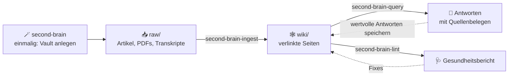

# 🧠 Second Brain Skills

> **Wirf Quellen rein. Bekomm ein Wiki raus, das sich selbst pflegt.**
> Vier Agent-Skills verwandeln PDFs, Artikel und Transkripte in einen verlinkten Obsidian-Wissensgraphen, den du befragen kannst und der dir Widersprüche meldet.




**Einrichten → befüllen → abfragen → verbessern.** Rohe Quellen bleiben unverändert. Das Wissen wächst in `wiki/`.

## ⚡ In 60 Sekunden starten

```bash
git clone https://github.com/guschi18/obsidian-skills.git
cp -r obsidian-skills/second-brain* ~/.claude/skills/
```

<details>
<summary>Windows (PowerShell)</summary>

```powershell
git clone https://github.com/guschi18/obsidian-skills.git
Copy-Item -Recurse obsidian-skills\second-brain* $HOME\.claude\skills```

</details>

Dann in Claude Code (oder einem anderen Agenten mit Skill-Pfad):

| Du sagst | Es passiert |
|---|---|
| „Richte ein Second Brain ein" | Wizard legt den Vault an (Name, Ort, Thema, Agent-Configs) |
| „Ich habe etwas in `raw/` gelegt" | Ingest fasst zusammen, fragt nach Schwerpunkten, baut Wiki-Seiten |
| „Was weiß ich über X?" | Query antwortet aus dem Wiki, jede Aussage mit `[[Wikilink]]` belegt |
| „Mach einen Health-Check" | Lint listet Fehler, Warnungen und Lücken, auf Wunsch mit Fixes |

## Worum es geht

Dieses Repository enthält lokale Skills für den Aufbau und die Pflege eines Obsidian-basierten Second Brains. Es ist kein fertiger Notizbestand, sondern ein Werkzeugkasten: Die Skills helfen dabei, einen neuen Vault zu initialisieren, Quellen zu verarbeiten, Fragen gegen das Wiki zu beantworten und die Qualität des Wissensgraphen regelmäßig zu prüfen.

Das System folgt dem **LLM Wiki Pattern**: Ein KI-Agent arbeitet als Bibliothekar. Rohe Quellen bleiben unverändert in `raw/`, während das eigentliche Wissen als strukturierte, verlinkte Markdown-Seiten in `wiki/` entsteht.

Dadurch wird aus einzelnen Artikeln, Transkripten, PDFs oder Notizen ein navigierbarer Wissensgraph:

- Welche Quellen stützen eine bestimmte Aussage?
- Welche Konzepte tauchen in mehreren Quellen wieder auf?
- Welche Personen, Organisationen, Produkte oder Tools sind miteinander verbunden?
- Welche Synthesen, Vergleiche und Analysen sind bereits entstanden?
- Wo fehlen Querverweise, Seiten oder aktuelle Quellen?

## Enthaltene Skills

| Skill | Rolle | Wofür er wichtig ist |
|---|---|---|
| `second-brain` | Onboarding Wizard | Erstellt einen neuen Obsidian-Vault mit Verzeichnisstruktur, Index, Log und Agent-Konfigurationen |
| `second-brain-ingest` | Quellenverarbeitung | Verarbeitet Dateien aus `raw/` zu Quellen-, Entitäten- und Konzeptseiten im Wiki |
| `second-brain-query` | Wissensabfrage | Beantwortet Fragen gegen `wiki/index.md`, Wiki-Seiten und optional lokale Suche mit `qmd` |
| `second-brain-lint` | Qualitätsprüfung | Findet kaputte Wikilinks, Waisen-Seiten, Widersprüche, veraltete Claims und fehlende Querverweise |

Zusammen bilden diese Skills einen vollständigen Arbeitszyklus: **einrichten, befüllen, abfragen, verbessern**.

## Perfekt für

Diese Skills sind besonders nützlich für:

- persönliche Obsidian-Wissensdatenbanken
- Recherche-Brains zu Fachthemen, Projekten oder Märkten
- LLM-gestützte Arbeit mit kontrollierten lokalen Quellen
- Aufbau eines versionierten Knowledge Graphs aus Webartikeln, PDFs, Transkripten und Notizen
- Teams oder Einzelpersonen, die Agenten mit klaren Wiki-Regeln arbeiten lassen wollen
- wiederholbare Workflows für Claude Code, Codex, Cursor oder Gemini CLI

## Obsidian als lokaler Wissensgraph

Der Ziel-Vault ist für Obsidian gebaut. Die Skills erzeugen und pflegen eine klare Wiki-Struktur:

- Quellen werden als eigene Summary-Seiten dokumentiert.
- Entitäten und Konzepte erhalten eigene Seiten.
- Alle internen Beziehungen laufen über `[[wikilinks]]`.
- `wiki/index.md` bleibt der Master-Katalog aller Seiten.
- `wiki/log.md` protokolliert jede Operation chronologisch.
- `wiki/synthesis/` sammelt wertvolle Vergleiche, Analysen und Querverbindungen.

Statt Informationen nur als lose Notizen abzulegen, entsteht ein lokales Wissenssystem, das von LLMs gezielt gelesen, erweitert und zitiert werden kann.

## Projektstruktur

```text
.
+-- second-brain/
|   +-- SKILL.md                      # Onboarding Wizard für neue Vaults
|   +-- scripts/
|   |   +-- onboarding.sh             # Erstellt raw/, wiki/, output/ und Basisdateien
|   +-- references/
|       +-- wiki-schema.md            # Kanonisches Schema für alle Ziel-Vaults
|       +-- tooling.md                # Empfohlene CLI-Tools
|       +-- agent-configs/
|           +-- claude-code.md        # Vorlage für CLAUDE.md
|           +-- codex.md              # Vorlage für AGENTS.md
|           +-- cursor.md             # Vorlage für .cursor/rules/second-brain.mdc
|           +-- gemini.md             # Vorlage für GEMINI.md
+-- second-brain-ingest/
|   +-- SKILL.md                      # Verarbeitet neue Quellen in Wiki-Seiten
+-- second-brain-query/
|   +-- SKILL.md                      # Beantwortet Fragen aus dem lokalen Wiki
+-- second-brain-lint/
    +-- SKILL.md                      # Prueft Wiki-Gesundheit und Konsistenz
```

## Wie das Wissen modelliert wird

Ein mit diesen Skills erzeugter Vault besteht aus drei Hauptbereichen:

| Ordner | Bedeutung |
|---|---|
| `raw/` | Unveränderte Originalquellen, z. B. Web-Clips, PDFs, Transkripte oder Notizen |
| `wiki/` | Strukturierter Wissensgraph, den der LLM-Agent pflegt |
| `output/` | Reports, Query-Ergebnisse und generierte Artefakte |

Jede Wiki-Seite besitzt YAML-Frontmatter:

```yaml
---
tags: [tag1, tag2]
sources: [source-filename.md]
created: YYYY-MM-DD
updated: YYYY-MM-DD
---
```

Die Wiki-Unterstruktur trennt die Rollen klar:

- `wiki/sources/` - eine Zusammenfassungsseite pro Quelle
- `wiki/entities/` - Personen, Organisationen, Produkte und Tools
- `wiki/concepts/` - Ideen, Frameworks, Muster und Theorien
- `wiki/synthesis/` - Analysen, Vergleiche und übergreifende Zusammenhänge

## Workflow

Der typische Ablauf ist bewusst einfach:

1. **Vault anlegen** mit `second-brain`
2. **Quellen sammeln** in `raw/`, idealerweise mit dem Obsidian Web Clipper
3. **Quellen ingestieren** mit `second-brain-ingest`
4. **Fragen stellen** mit `second-brain-query`
5. **Wiki prüfen** mit `second-brain-lint`

Der wichtigste Designpunkt: Quellen bleiben stabil, das Wiki wird kontinuierlich verdichtet.

## Agenten-Unterstützung

Der Onboarding-Skill kann Konfigurationsdateien für mehrere Agenten erzeugen:

| Agent | Datei im Ziel-Vault |
|---|---|
| Claude Code | `CLAUDE.md` |
| Codex | `AGENTS.md` |
| Cursor | `.cursor/rules/second-brain.mdc` |
| Gemini CLI | `GEMINI.md` |

Alle Templates verwenden dasselbe `wiki-schema.md`. Dadurch arbeiten verschiedene Agenten nach denselben Regeln und erzeugen kompatible Wiki-Seiten.

## Beispiel-Fragen an ein erzeugtes Brain

- Was weiß mein Wiki bereits über ein bestimmtes Unternehmen?
- Welche Quellen erwähnen ein bestimmtes Konzept?
- Welche Tools werden in mehreren Artikeln verglichen?
- Welche Aussagen widersprechen sich zwischen zwei Quellen?
- Welche Themen sind häufig erwähnt, aber noch nicht gut ausgearbeitet?
- Welche Synthese sollte aus den vorhandenen Notizen gespeichert werden?

## Quickstart im Detail

### Schritt 1 - Neuen Vault initialisieren

Starte den Skill `second-brain`. Der Wizard fragt nacheinander:

- Name des Vaults
- Speicherort
- Thema oder Domain
- gewünschte Agent-Konfigurationen
- optionale CLI-Tools

Danach erzeugt das Onboarding die Grundstruktur:

```text
raw/
raw/assets/
wiki/
wiki/sources/
wiki/entities/
wiki/concepts/
wiki/synthesis/
output/
wiki/index.md
wiki/log.md
```

### Schritt 2 - Quellen verarbeiten und abfragen

Lege Quellen in `raw/` ab und führe danach `second-brain-ingest` aus. Sobald die ersten Wiki-Seiten entstanden sind, kann `second-brain-query` Fragen gegen den lokalen Wissensbestand beantworten.

Nach größeren Änderungen oder etwa alle zehn Ingests sollte `second-brain-lint` laufen.

## Empfohlene Tools

| Tool | Zweck |
|---|---|
| Obsidian Web Clipper | Speichert Webartikel sauber als Markdown in `raw/` |
| `summarize` | Fasst Links, Dateien und Medien per CLI zusammen |
| `qmd` | Lokale Suche für größere Markdown-Wikis |
| `agent-browser` | Browser-Automation für Recherchefälle, in denen Standardtools nicht reichen |

Die Tools sind optional, aber für wachsende Vaults sinnvoll. Der Skill funktioniert auch ohne Datenbank oder Server.

## GitHub-Ziel

Dieses Repository repräsentiert den wiederverwendbaren Skill-Kern:

- Skill-Definitionen für Setup, Ingest, Query und Lint
- das kanonische Wiki-Schema
- Agent-Konfigurationsvorlagen für mehrere LLM-Umgebungen
- ein Onboarding-Script für neue Obsidian-Vaults
- Tooling-Hinweise für lokale Recherche- und Suchworkflows

Nicht enthalten sind persönliche Vault-Inhalte, private Quellen, lokale Obsidian-Einstellungen oder projektspezifische Wissensdatenbanken.

## CLAUDE.md – Claude Code Integration

Dieses Repository enthält eine `CLAUDE.md` für Claude Code. Sie steuert, wie der Agent bei Wissensfragen vorgeht:

```md
# Claude Anweisungen

Wenn der User eine Frage zu seinem Wissen stellt oder etwas sucht, schau zuerst welche Brains
es unter `D:\Brains\` gibt, lies die `wiki\index.md` der passenden Brains und folge dem
Query-Skill unter `{brain}\.claude\skills\second-brain-query\SKILL.md`.
```

**Was das bewirkt:** Statt allgemein zu antworten, navigiert Claude Code zuerst durch den lokalen Brain-Graphen und zieht seine Antworten aus dem konkreten Wissensbestand. So bleibt jede Antwort an echte, selbst gepflegte Quellen gebunden.

## Hinweis

Diese Skills erzeugen und pflegen lokale Wissensgraphen. Die Qualität der Antworten hängt von den eingepflegten Quellen, der Konsistenz des Wikis und regelmäßigen Lint-Prüfungen ab. Für fachlich verbindliche Entscheidungen sollten relevante Originalquellen immer mitgeprüft werden.
