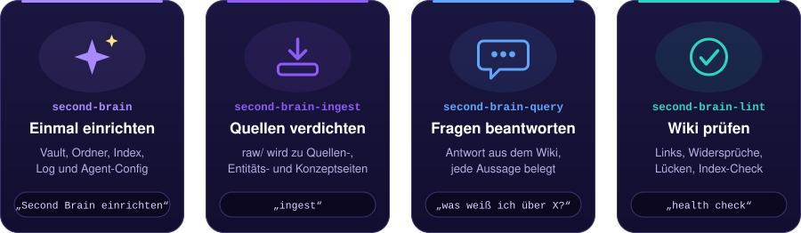

<h1 align="center"></h1>

<p align="center">
  <b>Wirf Quellen rein. Bekomm ein Wiki raus, das sich selbst pflegt.</b><br>
  Vier Agent-Skills machen aus PDFs, Artikeln und Transkripten einen verlinkten Obsidian-Wissensgraphen.<br>
  Du befragst ihn, er meldet Widersprüche.
</p>

<p align="center">
  
  
  
</p>

<p align="center">
  <a href="#-in-60-sekunden-starten"></a>
  <a href="#-was-dabei-herauskommt"></a>
  <a href="#-lint-in-aktion"></a>
  <a href="#enthaltene-skills"></a>
  <a href="#-faq"></a>
</p>

```bash
git clone https://github.com/guschi18/obsidian-skills.git && cp -r obsidian-skills/second-brain* ~/.claude/skills/
```

| 🪄 **Einrichten** | 📥 **Befüllen** | 💬 **Abfragen** | 🩺 **Verbessern** |
|:---:|:---:|:---:|:---:|
| `second-brain` | `second-brain-ingest` | `second-brain-query` | `second-brain-lint` |
| Vault anlegen | `raw/` → `wiki/` | Antwort mit Belegen | Fehler und Lücken finden |

<p align="center"></p>

## ⚡ In 60 Sekunden starten

<p align="center"></p>

<details>
<summary>Windows (PowerShell) statt bash</summary>

```powershell
git clone https://github.com/guschi18/obsidian-skills.git
Copy-Item -Recurse obsidian-skills\second-brain* $HOME\.claude\skills\
```

</details>

Dann in Claude Code (oder einem anderen Agenten mit Skill-Pfad):

| Du sagst | Es passiert |
|---|---|
| „Richte ein Second Brain ein" | Wizard legt den Vault an (Name, Ort, Thema, Agent-Configs) |
| „Ich habe etwas in `raw/` gelegt" | Ingest fasst zusammen, fragt nach Schwerpunkten, baut Wiki-Seiten |
| „Was weiß ich über X?" | Query antwortet aus dem Wiki, jede Aussage mit `[[Wikilink]]` belegt |
| „Mach einen Health-Check" | Lint listet Fehler, Warnungen und Lücken, auf Wunsch mit Fixes |

## 🔍 Was dabei herauskommt

<p align="center"></p>

## 🩺 Lint in Aktion

<p align="center"></p>

Nach etwa zehn Ingests laufen lassen. Lint meldet auch Widersprüche zwischen Quellen und veraltete Aussagen.

## Enthaltene Skills

<p align="center"></p>

## Warum nicht einfach …?

<p align="center"></p>

## Unter der Haube

<details>
<summary><b>Vault-Aufbau und Seitenformat</b></summary>

| Ordner | Bedeutung |
|---|---|
| `raw/` | Unveränderte Originalquellen (Web-Clips, PDFs, Transkripte, Notizen) |
| `wiki/` | Wissensgraph, den der Agent pflegt |
| `output/` | Reports, Query-Ergebnisse, generierte Artefakte |

Unterordner von `wiki/`: `sources/`, `entities/`, `concepts/`, `synthesis/`, dazu `index.md` und `log.md`.

Jede Seite beginnt mit YAML-Frontmatter:

```yaml
---
tags: [tag1, tag2]
sources: [source-filename.md]
created: YYYY-MM-DD
updated: YYYY-MM-DD
---
```

</details>

<details>
<summary><b>Agenten und Tools</b></summary>

| Agent | Datei im Vault |
|---|---|
| Claude Code | `CLAUDE.md` |
| Codex | `AGENTS.md` |
| Cursor | `.cursor/rules/second-brain.mdc` |
| Gemini CLI | `GEMINI.md` |

Optionale Tools: Obsidian Web Clipper (Quellen nach `raw/`), `summarize`, `qmd` (Suche ab ca. 100 Seiten), `agent-browser`.

</details>

## ❓ FAQ

<details>
<summary><b>Braucht es Obsidian?</b></summary>

Nein. Das Ergebnis ist reines Markdown mit `[[Wikilinks]]`. Obsidian zeigt nur den Graphen schöner an.

</details>

<details>
<summary><b>Kann der Agent meine Quellen verändern?</b></summary>

Nein. `raw/` ist unveränderlich, `wiki/log.md` ist append-only.

</details>

<details>
<summary><b>Wann lohnt sich Lint, wann `qmd`?</b></summary>

Lint nach etwa zehn Ingests. `qmd` (`npm i -g @tobilu/qmd`) ab etwa 100 Seiten. Query nutzt es automatisch.

</details>

Gefällt dir das Setup? Ein ⭐ auf GitHub hilft anderen, es zu finden.

*Antworten sind nur so gut wie deine Quellen. Prüfe bei wichtigen Entscheidungen die Originale.*
